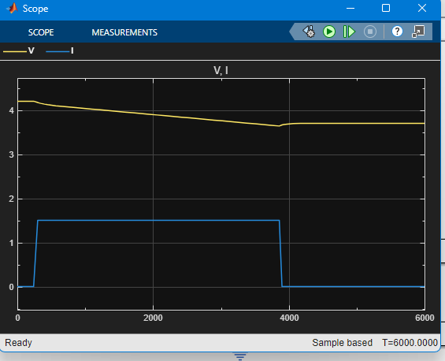
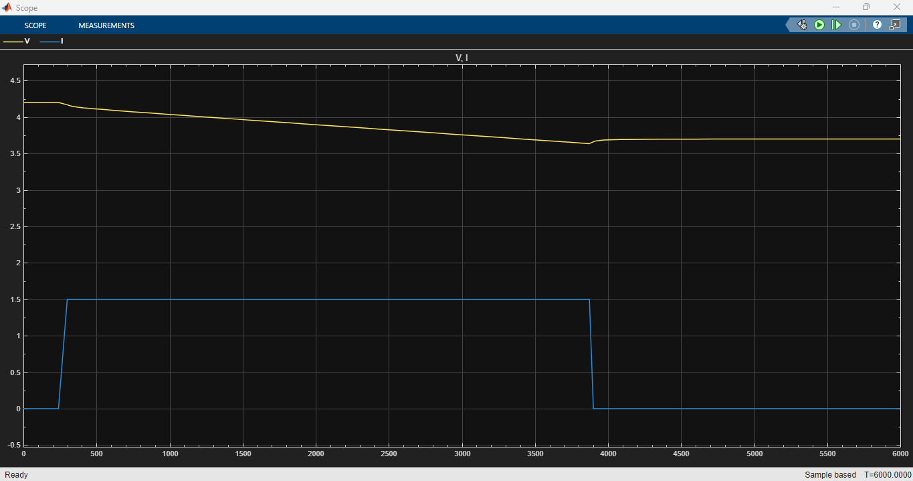
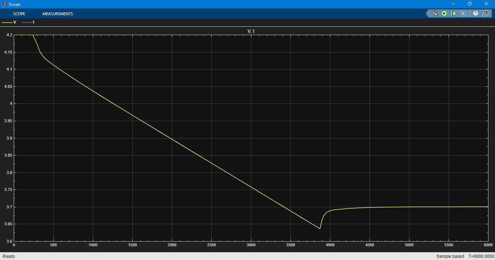
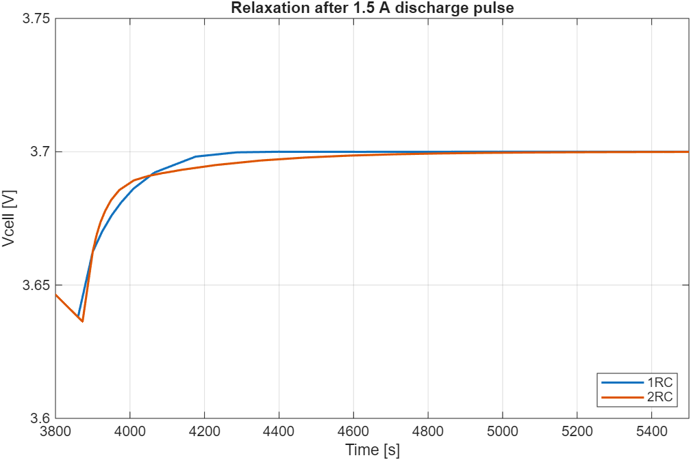

# Li-ion Cell Equivalent-Circuit Models: 1RC vs 2RC (MATLAB/Simulink)

Thevenin equivalent-circuit models of a 3 Ah Li-ion cell built in Simulink/Simscape, tested with the same pulse discharge and compared on voltage relaxation.

## Model
`V = OCV(SOC) - I*R0 - V1 (- V2)`

| Parameter | 1RC | 2RC |
|---|---|---|
| Capacity | 3.0 Ah | 3.0 Ah |
| R0 | 0.02 ohm | 0.02 ohm |
| R1 / tau1 | 0.025 ohm / 100 s | 0.015 ohm / 30 s |
| R2 / tau2 | none | 0.010 ohm / 300 s |

The 1RC branch uses the sum of the two 2RC polarization resistances, so total polarization is equal and the comparison is fair.

OCV table: SOC `[0 0.2 0.5 0.8 1.0]` -> V0 `[3.0 3.5 3.7 4.0 4.2]` V, initial SOC 100 %.

## Test
Pulse discharge: 0 A until 300 s (rest), 1.5 A from 300 s to 3900 s, then 0 A (rest) until 6000 s.

## Files
| File | Description |
|---|---|
| `one_RC_Cell.slx` | 1RC cell model |
| `two_RC_Cell.slx` | 2RC cell model |
| `1Rc.png` | 1RC test result (voltage and current) |
| `Two_RC.png` | 2RC test result (voltage and current) |
| `Two_RC_Zoom.png` | 2RC voltage, zoomed on the relaxation |
| `1RC_vs_2RC.png` | 1RC vs 2RC comparison |

## Results

### 1RC cell


### 2RC cell




### 1RC vs 2RC


- Both models show the same instant drop/jump (I*R0 = 30 mV) and settle at 3.70 V, the OCV at 50 % SOC.
- The 1RC model relaxes with a single time constant.
- The 2RC model adds a slow tail from the second branch, which the 1RC model cannot reproduce.

## How to run
1. Set the parameters in the MATLAB Command Window.

   For `one_RC_Cell.slx`:
   ```matlab
   Qcell = 3.0; R0cell = 0.02;
   R1cell = 0.025; tau1 = 100;
   ```
   For `two_RC_Cell.slx`:
   ```matlab
   Qcell = 3.0; R0cell = 0.02;
   R1cell = 0.015; tau1 = 30;
   R2cell = 0.010; tau2 = 300;
   ```
2. Open the `.slx` model and press Run (solver ode23t, stop time 6000 s).

Requires MATLAB, Simulink, Simscape and Simscape Electrical (Battery Table-Based block).

## Next steps
- Extended Kalman Filter for SOC estimation using this cell model
- Parameter fitting from pulse-test data
- SOC/temperature-dependent parameters
- Use the cell as the plant in a CC-CV charger
